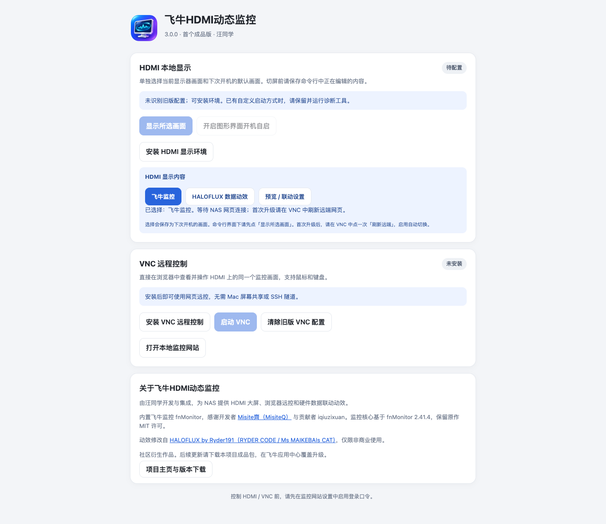
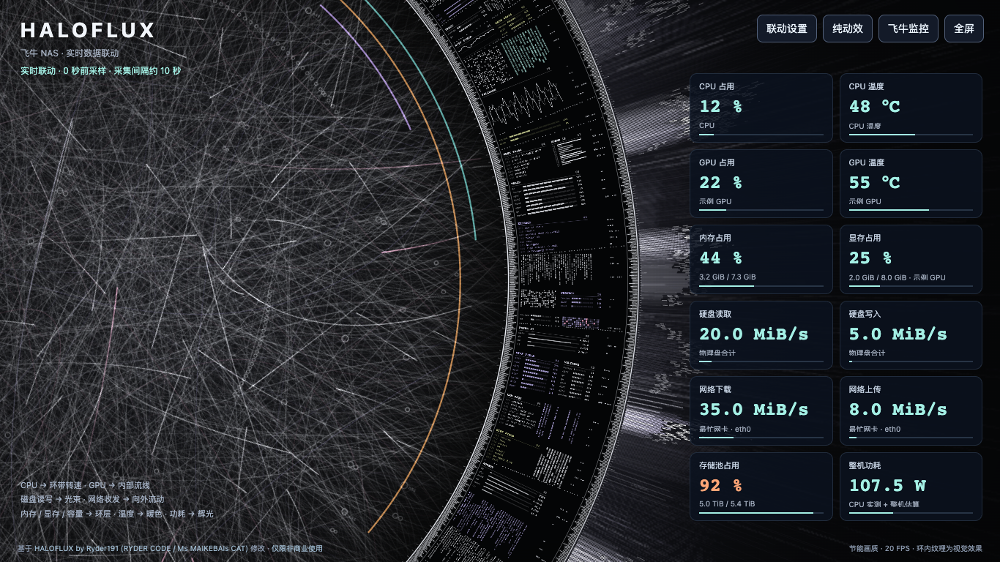

<p align="center"></p>

# 飞牛HDMI动态监控

**让 NAS 的 HDMI 屏幕成为可远程操作的监控与动态可视化大屏。**

开发与集成：**汪同学** · 首个成品版：**3.0.0** · 平台：**fnOS x86_64**

本项目内置 **[飞牛监控 fnMonitor](https://github.com/MisiteQ/fnmonitor)**，在监控核心之外增加 HDMI 显示管理、浏览器 VNC、HALOFLUX 硬件联动及大屏交互。感谢 fnMonitor 开发者 **Misite齊（MisiteQ）**、**iqiuzixuan** 及原项目贡献者。

这是社区衍生项目，尚未与 fnOS、fnMonitor 或 HALOFLUX 作者建立官方合作关系。欢迎原作者交流集成方式与后续合作。

## 功能

- **HDMI 显示管理**：安装与卸载显示环境，切换命令行和图形画面，独立设置开机默认画面。
- **浏览器远控**：安装／卸载 VNC，启动后点击“开始控制”，在网页操作 HDMI 上的同一个桌面，支持鼠标、键盘与全屏。
- **两种显示内容**：飞牛监控仪表盘或 HALOFLUX 数据动效，选择保存后下次启动继续使用。
- **硬件数据联动**：CPU、GPU、内存、显存、温度、磁盘读写、存储池占用、网络和功耗驱动动效；支持选择设备及调整强度、参考上限和帧率。
- **大屏体验**：一屏显示、远端缩放快捷键、工具栏收起、鼠标闲置 5 秒自动隐藏，移动／点击／滚动恢复。
- **操作反馈**：安装、卸载、启停显示运行状态、耗时与日志。
- **内置监控**：保留 fnMonitor 的系统概览、容器、虚拟机、历史趋势、配置与数据功能。

## 界面预览





上图为本地验证截图；HALOFLUX 数值是明确构造的示例数据，并非真实 NAS 读数。

## 最新版本：3.0.9

用户已于 2026-11-09 确认测试正常。更新包含 HDMI 常亮、16:9 分辨率适配、VNC 无人连接 30 分钟自动停用、HALOFLUX 标题定制与逐项复位，以及卸载清理与升级数据保护。

发布包与已验证的 3.0.9 测试包字节一致，界面可能仍显示测试版字样。覆盖升级后刷新页面，并点击当前 HDMI 分辨率以确认常亮；已有 VNC 停止再启动一次。

卸载顺序仍是：在控制面板底部点击「一键卸载并清除残留」，等清理成功并返回命令行后，再去飞牛应用商店卸载。监控历史由卸载向导决定是否删除；其他服务共用依赖不会盲目删除。

## 下载与升级

从本仓库 **Releases** 下载 `fnhdmi-monitor-3.0.9-x86.fpk`，在飞牛应用中心手动安装。

已有定制版 2.41.9 的用户直接**覆盖升级，不要先卸载**。升级后重新打开应用，进入 VNC，点击一次“刷新远端”，加载最新页面。桌面若仍缓存旧图标，可刷新飞牛桌面网页。

为延续已有数据，本版的内部应用标识仍是 `fnmonitor`，默认端口为 `8777`。它会替换现有 fnMonitor 应用，**不能与原版作为两套应用并行安装**。显示名称是“飞牛HDMI动态监控”。

首版使用应用中心安装完整 FPK 的升级方式。内置原版监控的在线安装和自动更新已由产品更新策略接管，避免上游包覆盖 HDMI／VNC／动效功能；用户原有配置文件中的开关值不会被改写。新的成品版本发布在本仓库 Releases。

升级前脚本备份配置与数据库到程序数据目录下的 `.display-upgrade-backups/`。保留原有监控历史、自定义数据目录、界面设置和场景选择。

## 首次使用

1. 打开“飞牛HDMI动态监控”，进入本地监控网站，设置登录口令。
2. 在 HDMI 区域安装显示环境，按提示接入已有配置或设置显示。
3. 选择“飞牛监控”或“HALOFLUX”，点击“显示所选画面”。开机自启可独立开关。
4. 需要远控时，在 VNC 区域安装远程控制，启动后点击“开始控制”。
5. HALOFLUX 右上角“联动设置”可选择磁盘、网卡、GPU，调整画质与动效。也可隐藏数据卡，仅显示动效。

HDMI 和 VNC 环境分开管理。卸载根据安装记录清理本项目创建的服务、文件和配置；已有依赖、共享组件及用户自己安装的环境不会被盲目删除。旧版无法确认归属的配置会提示处理，不承诺删除未知第三方文件。

## 动效如何响应数据

| 数据 | 动效 |
| --- | --- |
| CPU / GPU 占用 | 光环 / 内部光点速度 |
| 磁盘读取 / 写入 | 光束速度 / 粒子与爆发数量 |
| 网络下载 / 上传 | 外射光束速度和长度 / 爆发频率 |
| 内存 / 显存 | 光点密度与弧形进度 |
| 存储池占用 | 外环亮度及进度颜色 |
| CPU / GPU 温度 | 暖色覆盖与弧形颜色 |
| 整机功耗 | 辉光及光束亮度 |

页面每 2 秒读取已有采样缓存，实际刷新由监控采集间隔决定，不增加硬盘扫描任务。缺失传感器显示“—”；共享内存 GPU 不伪造独立显存；估算功耗与估算占用会注明来源。采样过期时显示不可用并回到待机。

默认节能画质、24 FPS；CPU 采样占用超过 85% 时限制为 12 FPS；页面隐藏时停止绘制。动效仍有资源开销，实际效果取决于 NAS 性能与显示分辨率。

## 构建与验证

监控核心基于官方 fnMonitor **2.41.4 x86 FPK**，来源摘要见 `BUILD-PROVENANCE.json`。HALOFLUX 固定来源见 `HALOFLUX-SOURCE.json`。

安装官方 fnOS `fnpack` 工具后，在仓库根目录执行：

```sh
fnpack build
```

生成的 `fnmonitor.fpk` 可重命名为发行文件名。构建前清理 `app/` 下的 `__pycache__`；不应打入数据库、登录会话或运行时配置。

关键回归测试（Python 3.12）：

```sh
PYTHONPATH=tests python3 -m unittest test_display_control test_browser_control test_vnc_startup test_halo test_product -v
```

`tools/verify_package.py 旧版.fpk 新版.fpk` 在临时目录执行真实升级脚本，验证配置、历史、登录状态与场景设置保留。浏览器验证工具使用 Playwright 和 macOS Edge，需设置 `PW_PATH` 指向 Playwright 模块目录。浏览器测试数据为人工构造，不是用户 NAS 数据。

HDMI／VNC／HALOFLUX 功能的前一版已由用户在真实 NAS 验证；3.0.0 的品牌、更新策略与打包改动通过本地回归和隔离升级验证，仍欢迎不同硬件反馈。

## 致谢与许可

- **fnMonitor**：Misite齊（MisiteQ）、iqiuzixuan 及贡献者，MIT；保留原项目内的全部署名和致谢。
- **HALOFLUX by Ryder191 (RYDER CODE / Ms MAIKEBAIs CAT)**：动效由其原作修改，源项目 <https://github.com/Ryder191/haloflux>。采用 **PolyForm Noncommercial 1.0.0 及 Required Notices，仅限非商业使用**。完整声明见 `LICENSES/HALOFLUX.txt`。
- **noVNC**：浏览器 VNC 客户端，MPL 2.0；其他依赖保留各自许可。
- HDMI／VNC／动效集成及产品改动署名 **汪同学**；新图标使用 AI 辅助制作，不是 fnOS 官方图标。

本仓库不是对所有文件统一授予 MIT 许可。集成代码与 fnMonitor 的 MIT 许可不改变 HALOFLUX 的非商业限制。请阅读 [第三方说明](THIRD_PARTY_NOTICES.md) 和各目录许可证后使用、修改或分发。

## 合作与问题反馈

欢迎通过仓库 Issues 交流硬件适配、问题复现与合作。提交日志前请删除密码、令牌、会话信息和私人地址。项目由汪同学维护；不会把本项目的问题反馈自动发送到原作者仓库。
